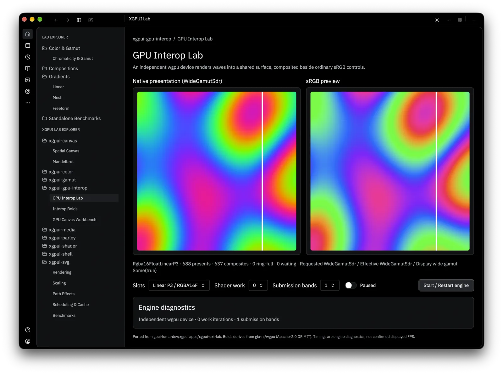

# xgpui

An extensible GPUI framework with custom shaders, wide-gamut rendering and tools
for building applications such as photo editors, backed by documentation and tests.

XGPUI started from [gpui-unofficial](https://github.com/gpui-archipelago/gpui-unofficial),
which captures GPUI and its supporting crates from
[Zed](https://github.com/zed-industries/zed). We are moving toward using Zed
directly as our upstream.

**[Read the documentation →](https://xgpui.dev/)**

## Latest release

**XGPUI 5.0.0**, released November 22, 2026, tracks upstream
**gpui-unofficial 1.29.3** (Zed `v1.29.3`). The captured upstream release and
commit are recorded in [`upstream.json`](upstream.json); XGPUI crates keep their
own version numbers, independent of the upstream version.

- Highlights: every `Element` is an `IntoElement` through a blanket impl, lighter
  `Div` builders, text-system speedups, color glyphs composited on the CPU on
  Windows, and Canvas spatial editing APIs.
- Upgrading from 4.x: the [GPUI 1.29.3 migration guide](https://xgpui.dev/gpui-1.29-migration.html)
  lists every compile-breaking change and its fix. Update the GPUI family together.
- [Release notes](https://github.com/gpui-luma-dev/xgpui/releases/latest) ·
  [What's new](https://xgpui.dev/whats-new.html) ·
  [All migration guides](https://xgpui.dev/migration-guides.html)

## Lookless UI controls: xgpui-luma

[xgpui-luma](https://github.com/gpui-luma-dev/xgpui-luma) is the lookless UI
controls suite built on XGPUI: controls, layouts, focus, interaction and motion in
one SDK, with Shadcn and Radix looks as separate adapters, plus color controls and
charts. Documentation: [gpui-luma.dev](https://gpui-luma.dev).

Its **XGPUI Lab** app brings most of XGPUI's extension labs together in one
application: canvas, color, gamut, GPU interop, media, Parley text, shaders, the
desktop shell and SVG.



## How it works

- Modified framework/backend crates are captured under `gpui/`; supporting
  crates use the matching published `gpui-unofficial` packages. `upstream.json`
  records the release, source commit, local packages and registry dependencies.
- The local `tools/release-sync` tool imports a selected release onto a review
  branch, keeping it separate from local development.
- Release updates are reviewed and integrated into `main`. Documentation,
  tooling and experimental changes live alongside the captured code.

## Build

From the repository root:

```sh
just         # List sample apps and development commands.
just build   # Build optimized native libraries.
just shader # Launch the shader examples.
```

On Linux, install the system packages and Rust first with
`scripts/linux_setup.sh` and `scripts/linux_rust.sh`, then check the machine with
`scripts/linux_doctor.sh`; see [Linux setup](docs/LINUX-SETUP.md).

Recipes use Bash (on Windows, Git for Windows Bash must be on PATH).
Without just, use `cargo build --release --locked`.

`just labs build` builds the unpublished extension labs and benchmarks from
`apps/xgpui-ext-lab/`. See [Labs & benchmarks](https://xgpui.dev/extension-lab.html)
for targets, launch commands and why the lab package is unpublished.

`just build` builds the libraries supported by the selected target; it does not
launch an application.

## Documentation website

The website at <https://xgpui.dev/> is the static `pages/` directory: guides,
crate pages and the browser demos. Preview and check it without building:

```sh
just pages-serve
just pages-check
```

See [website deployment](docs/RELEASING.md#website-deployment) for publishing.

## Contributing

Contributions are welcome, including fully AI-generated code. You are responsible
for its quality. See [Contributing](CONTRIBUTING.md) for the short guide.

## License

[Apache License 2.0](LICENSE), consistent with GPUI from Zed.
Upstream copyright and license notices are preserved.
