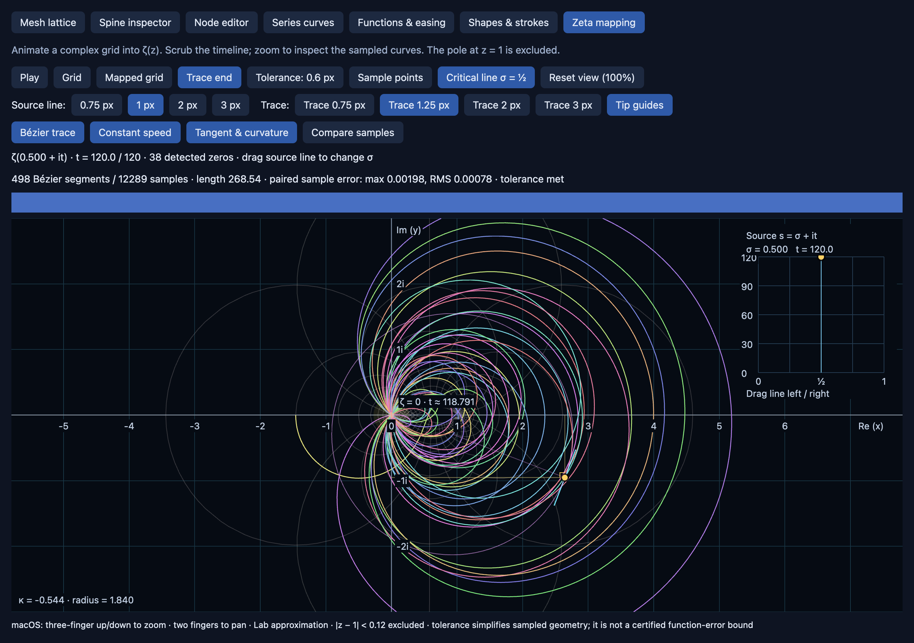

# Initial review baseline

Captured on 2026-11-23, macOS / Apple silicon, **debug build**. These are local
reference measurements, not portable thresholds or optimized performance claims.



## Reproduce

From the repository root:

```sh
just curve zeta-capture
just curve zeta-benchmark
# Match this baseline's debug profile instead of the registry's release default:
just labs --profile dev curve zeta-capture
just labs --profile dev curve zeta-benchmark
```

Outputs go to `target/zeta-review/`. Capture opens a 1280×900 logical-pixel native
window, renders six paused states, checks that the images differ and have visible
foreground, saves PNGs plus `captures.json`, and exits. Physical dimensions follow
display scale (2560×1800 here). Keep the window unobscured during the run. The
capture task exercises the real root view without holding a root-entity update
across an explicit draw. The completed frame is retained here for review; all six
frames can be regenerated.

The CPU benchmark needs no window. For each σ it warms once and records five
trials, using the same 12,289 samples and fit configuration. Raw data is checked
in alongside this document. Median milliseconds:

| σ | Function evaluation | Parameter fitting | Measurement/cache setup | Clip + stroke/tessellation | Segments |
| --- | ---: | ---: | ---: | ---: | ---: |
| 0.1 | 32.868 | 13.732 | 9.061 | 5.814 | 623 |
| 0.5 | 32.432 | 12.655 | 7.024 | 5.039 | 498 |
| 0.9 | 32.305 | 11.519 | 5.704 | 3.600 | 404 |

Evaluation excludes the background grid and zero detection. Path building uses
the complete fitted trace at 100 pixels/unit in a 900×600 viewport. Fitting and
measurement happen on source-line changes, not on every animation frame.

The six capture states report CPU draw composition (8.6–18.0 ms here) separately
from GPU rendering **plus synchronous readback** (202–208 ms here). Readback costs
are not display presentation timings or end-to-end FPS. PNG encoding is excluded.
There is no claim to isolate GPU execution from synchronization/readback.

## Browser check

The shared gallery built successfully with wasm-bindgen 0.2.129 using:

```sh
bash apps/xgpui-ext-lab/extensions-web/build.sh
just pages-serve
```

The zeta panel at `?demo=curve&panel=zeta` rendered in the in-app browser; selecting
Trace end displayed the complete fitted trace, source inset, axes, and inspector.
This is a basic runtime smoke check, not forced-WebGPU/WebGL2 or full gesture QA.
The generated web bundle stays outside the committed source changes.

## Remaining review

See [API_REVIEW.md](../API_REVIEW.md). Core input API decisions are still pending.
Windows/Linux native behavior is unverified locally; rely on CI until changes
reach main. Adaptive sampling and the other issue 430 follow-ups remain separate
work. The current benchmark is a baseline, not a performance regression gate.
