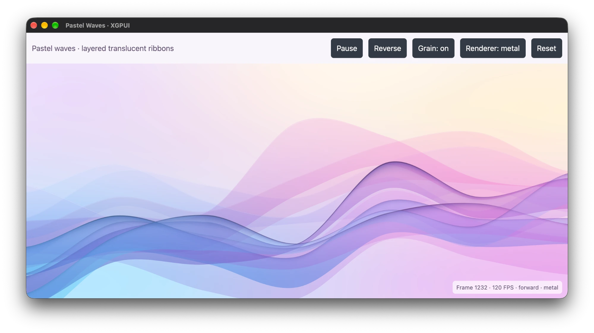

# Performance Study

Pastel waves (`paint-lab --pastel-waves`): nine translucent antialiased
mesh-gradient ribbons over a five-point freeform background and nine radial
tint fields, with per-ribbon veils, variable-width rims, lip highlights, five
thread lines and hashed grain. Target: sustained 120 Hz with headroom.

Platform: Apple M4 Max, macOS, release builds, 2560 × 1562 device pixels
(1280 × 781 logical at 2×). All code below is from
`apps/xgpui-ext-lab/paint-lab/src/` unless marked otherwise; excerpts are
trimmed with `…`.



*The native Metal producer animating at 120 FPS on the laptop's 120 Hz
display, after row culling.*

## Baseline

| Renderer | Implementation | Cost |
| --- | --- | --- |
| `paths` | Brush fills over native path coverage; geometry rebuilt per frame | ~177 ms/frame (debug), ~6 FPS |
| `wgsl` | One instanced WGSL draw; each fragment evaluates all 9 ribbons | 6.0 ms GPU (saturated) |
| `metal` | `CustomContent` producer: compute pass per column + one fragment pass | 6.3 ms GPU per frame at 120 Hz |

Frame breakdown at 120 Hz (Metal producer, pre-optimization):

| Component | Mean | p99 |
| --- | --- | --- |
| Frame callback, total | 4.84 ms | 6.09 ms |
| `nextDrawable` wait | 3.63 ms | 5.03 ms |
| CPU work excluding wait | 1.22 ms | 2.93 ms |
| Command encoding | 0.29 ms | 0.46 ms |
| GPU, producer start → main pass end | 6.29 ms | 7.90 ms (max 8.78) |

The workload is GPU-bound: 6.3 of 8.33 ms, with the worst frames over budget.
CPU work and encoding are an order of magnitude below the limit.

## Problem 1: frame rate does not expose cost

**Problem.** FPS is quantized to the display: 60 on a 60 Hz panel, 120 on a
ProMotion panel, for every frame that completes in time. It reports no
headroom.

**Measurement pitfalls.**

- The producer command buffer and GPUI's main pass overlap on the GPU (4.2 ms
  overlap measured). Summing per-buffer spans gives 10.5 ms for a frame that
  completes at 120 Hz. The valid span is producer `GPUStartTime` → main pass
  `GPUEndTime`.
- Frame callback time includes `nextDrawable` blocking (vsync back-pressure),
  which is idle time, not work.
- Apple GPU DVFS lowers the clock under light load. A shader that does less
  work can report the same milliseconds at a lower clock: the culled WGSL
  shader showed 6.3 ms in-app before and after a change that removed ~20% of
  its work.

**Solution.** Measure three quantities separately.

GPU span per command buffer, from a completion handler. This was temporary
instrumentation in `gpui-apple`'s `MetalRenderer::draw` and in
`submit_custom_commands`; it is not part of the repository:

```rust
// Not in the repository: temporary measurement hook.
let block = RcBlock::new(move |cb: ptr::NonNull<ProtocolObject<dyn MTLCommandBuffer>>| {
    let cb = unsafe { cb.as_ref() };
    eprintln!("TMGPUMAIN {:.4} {:.6} {:.6}",
        (cb.GPUEndTime() - cb.GPUStartTime()) * 1000., cb.GPUStartTime(), cb.GPUEndTime());
});
unsafe { command_buffer.addCompletedHandler(RcBlock::as_ptr(&block)) };
```

Logging absolute start and end times for both buffers gives the true frame
span (producer start → main end) and their overlap.

Saturated GPU cost, with the clock pinned high by rendering back to back
offscreen and subtracting an empty scene's readback. Also a temporary test,
not in the repository:

```rust
// Not in the repository: temporary benchmark, run as a paint-lab unit test.
let mut renderer = gpui_platform::current_headless_renderer()?.expect("native");
let extent = size(DevicePixels(2560), DevicePixels(1562));
for frame in 0..360 {
    let phase = 0.5 * PI * (1. - (frame as f32 * 0.012).cos());
    let mut scene = Scene::default();
    scene.insert_primitive(CustomDraw {
        order: 0, bounds, content_mask: ContentMask { bounds },
        corner_radii: Corners::default(), opacity: 1., coverage: None,
        content: Arc::new(native::PastelWavesNative {
            phase, grain: true, scale: 2., fill_bounds: fill_bounds(phase),
        }),
    });
    scene.finish();
    let start = Instant::now();
    renderer.render_scene_to_image(&scene, extent)?; // waits for completion
    if frame >= 60 { times.push(start.elapsed()); }  // median minus empty scene
}
```

Old and new variants were run alternately, three repetitions each; run-to-run
noise was ±0.3 ms.

## Platform measurement tools

Two external tools complement the in-app measurements: a HUD overlaid on the
running app (frame rate, frame time, GPU time) and a system monitor that
reports GPU clock, load and power, which shows whether a timing change is real
work or clock scaling. Only the macOS tools were used in this study.

> **macOS (Metal) · used in this study**
>
> **Metal Performance HUD.** Set `MTL_HUD_ENABLED=1` for any Metal app
> launched from a terminal; the overlay shows frame rate, frame time, GPU time
> and memory:
>
> ```sh
> MTL_HUD_ENABLED=1 cargo run --release --locked --config .cargo/validation.toml \
>   --manifest-path apps/xgpui-ext-lab/Cargo.toml --bin paint-lab \
>   --features portable-shaders -- --pastel-waves
> ```
>
> **powermetrics.** GPU active frequency, residency and power, sampled every
> 500 ms. It requires `sudo` and must sample while the app animates. With `-o`
> it writes only to the file and prints nothing.
>
> ```sh
> sudo powermetrics --samplers gpu_power -i 500 -n 20
> ```

> **Windows (D3D11) · not yet used in this study**
>
> **HUD:** [PresentMon](https://github.com/GameTechDev/PresentMon) (overlay and
> CSV capture of per-frame present timing and GPU busy time), or the Xbox Game
> Bar performance widget (`Win+G`) for frame rate and GPU load.
>
> **GPU monitor:** Task Manager's per-engine GPU graphs (3D and Compute) for
> load; vendor tools for clock and power, for example
> `nvidia-smi --query-gpu=clocks.gr,power.draw,utilization.gpu --format=csv -l 1`
> on NVIDIA.

> **Linux (wgpu on Vulkan) · not yet used in this study**
>
> **HUD:** [MangoHud](https://github.com/flightlessmango/MangoHud), a Vulkan
> layer overlay with frame rate, frame time, GPU load, clock and power. Prefix
> the launch command; the layer applies to the app cargo starts:
>
> ```sh
> mangohud cargo run --release --locked --config .cargo/validation.toml \
>   --manifest-path apps/xgpui-ext-lab/Cargo.toml --bin paint-lab \
>   --features portable-shaders -- --pastel-waves
> ```
>
> **GPU monitor:** `intel_gpu_top` (Intel), `nvidia-smi … -l 1` (NVIDIA),
> `amdgpu_top` or `radeontop` (AMD), or `nvtop` across vendors.

## Problem 2: per-pixel evaluation of per-column data

**Problem.** Each ribbon edge is a Catmull-Rom spline in `u` (seven knots),
plus sinusoidal drift and, for foreground ribbons, a fold strength computed
from a finite-difference second derivative (three more spline evaluations).
None of it depends on `y`, yet the single-pass shader recomputes it for every
pixel: 18 spline evaluations, 36 trig calls and 12 fold-strength splines per
fragment.

`pastel_waves.wgsl`, inside the per-pixel ribbon loop:

```wgsl
for (var r = 0u; r < 9u; r += 1u) {
    // …
    let top = ribbon_edge(r, 0u, u);
    let bottom = ribbon_edge(r, 1u, u);
    let drift = ribbon_motion(r, u, phase);
    // … and for r >= 5u:
    let s = fold_strength(r, u); // three more ribbon_edge calls
```

The spline itself, shared by every shader (`pastel_waves/pastel_waves.metal`):

```metal
// Catmull-Rom edge (x: value, y: d/du), matching edge_y in pastel_waves.rs.
static float2 ribbon_edge(uint r, uint side, float u) {
    float x = clamp(u, 0.0f, 1.0f) * 6.0f;
    int i = min(int(floor(x)), 5);
    float t = x - float(i);
    uint base = r * 14u + side * 7u;
    float a = RIB_EDGES[base + uint(max(i - 1, 0))];
    float b = RIB_EDGES[base + uint(i)];
    float c = RIB_EDGES[base + uint(i + 1)];
    float d = RIB_EDGES[base + uint(min(i + 2, 6))];
    float c1 = -a + c;
    float c2 = 2.0f * a - 5.0f * b + 4.0f * c - d;
    float c3 = -a + 3.0f * b - 3.0f * c + d;
    float value = 0.5f * (2.0f * b + c1 * t + c2 * t * t + c3 * t * t * t);
    float slope = 3.0f * (c1 + 2.0f * c2 * t + 3.0f * c3 * t * t);
    return float2(value, (u >= 0.0f && u <= 1.0f) ? slope : 0.0f);
}
```

**Solution.** A native producer with two passes. A compute pass evaluates every
ribbon once per pixel column and writes two `float4` per ribbon per column; the
fragment pass reads its column and only shades. The buffer is
`width × 9 × 2 × 16` bytes, 720 KB at 2560 columns.

`pastel_waves/pastel_waves.metal`, the column pass (culling lines omitted
here; see Problem 3):

```metal
// Per column x and ribbon r, two float4s at (x * 9 + r) * 2:
//   [0] top value, top d/du, bottom value, bottom d/du (drift included)
//   [1] fold strength (foreground ribbons), then the device-pixel y range
//       outside which every layer of this ribbon has exactly zero coverage
kernel void pastel_columns(device float4 *columns [[buffer(0)]],
                           constant Uniforms &uniforms [[buffer(1)]],
                           uint x [[thread_position_in_grid]]) {
    uint width = uint(uniforms.extent.x);
    if (x >= width) {
        return;
    }
    float2 size = max(uniforms.extent.xy, float2(1.0f));
    float u = (float(x) + 0.5f) / float(width);
    for (uint r = 0u; r < 9u; r++) {
        float2 drift = ribbon_motion(r, u, uniforms.frame.x);
        float2 top = ribbon_edge(r, 0u, u) + drift;
        float2 bottom = ribbon_edge(r, 1u, u) + drift;
        float strength = r >= 5u ? fold_strength(r, u) : 0.0f;
        // … y range, see Problem 3
        columns[(x * 9u + r) * 2u] = float4(top, bottom);
        columns[(x * 9u + r) * 2u + 1u] = float4(strength, lo - 1.0f, hi + 1.0f, 0.0f);
    }
}
```

The fragment pass covers the target with one oversized triangle and reads the
column instead of evaluating curves:

```metal
vertex VertexOut pastel_vertex(uint id [[vertex_id]]) {
    float2 uv = float2(float((id << 1u) & 2u), float(id & 2u));
    VertexOut out;
    out.position = float4(uv * float2(2.0f, -2.0f) + float2(-1.0f, 1.0f), 0.0f, 1.0f);
    return out;
}

fragment float4 pastel_fragment(VertexOut in [[stage_in]],
                                constant Uniforms &uniforms [[buffer(0)]],
                                device const float4 *columns [[buffer(1)]]) {
    // …
    uint column = min(uint(pixel.x), uint(size.x) - 1u);
    // … background
    for (uint r = 0u; r < 9u; r++) {
        float4 extra = columns[(column * 9u + r) * 2u + 1u];
        // … cull, see Problem 3
        float4 edges = columns[(column * 9u + r) * 2u];
        float2 top = edges.xy;
        float2 bottom = edges.zw;
        // … shading only
```

The producer is a `CustomContent`. The app paints one immutable snapshot per
frame (`pastel_waves.rs`):

```rust
fn paint_waves_native(bounds: Bounds<Pixels>, phase: f32, grain: bool, window: &mut Window) {
    let content: std::sync::Arc<dyn CustomContent> =
        std::sync::Arc::new(native::PastelWavesNative {
            phase,
            grain,
            scale: window.scale_factor(),
            fill_bounds: fill_bounds(phase),
        });
    window.paint_custom(
        CustomGeometry::RoundedRect {
            bounds,
            corner_radii: Corners::default(),
        },
        content,
    );
}
```

`prepare` records both passes into the host's batch and returns the output
texture; GPUI submits the batch and composites the texture at scene order. The
Metal recording (`pastel_waves/metal.rs`):

```rust
let command = ctx.record(|command| {
    let compute = command
        .computeCommandEncoder()
        .context("Metal compute encoder allocation failed")?;
    compute.setComputePipelineState(&pipelines.columns);
    unsafe { compute.setBuffer_offset_atIndex(Some(&*columns), 0, 0) };
    unsafe {
        compute.setBytes_length_atIndex(uniform_bytes, std::mem::size_of::<Uniforms>(), 1)
    };
    // … one thread per column, threadExecutionWidth per group
    // Tracked resources order the column writes before the fragment reads.
    compute.endEncoding();
    // … render pass: DontCare load, Store, pastel_fragment, one triangle
    Ok(())
})?;
Ok(Box::new(MetalCustomOutput {
    texture,
    commands: vec![command],
}))
```

Pipelines are compiled once per device and queue and cached in a static; the
column buffer and output texture are allocated per frame (0.29 ms total
encoding, not a bottleneck).

## Problem 3: every pixel shades every ribbon

**Problem.** Each ribbon contributes up to five layers per pixel (fill, veil,
rim, lip, threads), each with one or two antialiased edge tests (`rsqrt`), a
mesh-color interpolation and, with grain, an integer hash and a soft-light
blend. A ribbon covers a band a fraction of the target's height, but all nine
are shaded everywhere.

The coverage primitives (`pastel_waves/pastel_waves.metal`):

```metal
// Coverage below a curve (value, d/du) from perpendicular distance in device px.
static float below(float2 curve, float y, float2 size) {
    float slope = curve.y * size.y / size.x;
    float distance = (y - curve.x * size.y) * rsqrt(1.0f + slope * slope);
    return clamp(0.5f + distance, 0.0f, 1.0f);
}

static float band(float2 top, float2 bottom, float fa, float fb, float y, float2 size) {
    return abs(below(top + (bottom - top) * fa, y, size) - below(top + (bottom - top) * fb, y, size));
}

static float3 over(float3 dst, float3 color, float alpha) {
    float a = clamp(alpha, 0.0f, 1.0f);
    return saturate(color) * a + dst * (1.0f - a);
}
```

**Solution: exact row culling.** Per ribbon and column, compute a device-pixel
interval `[y_min, y_max]` outside which all five layers have zero coverage, and
skip the ribbon there. Since `over(dst, c, 0) == dst` exactly, the skip is
lossless provided the interval is conservative:

- `below` reaches 0 or 1 at a vertical offset of `0.5 √(1 + s²)` from the edge,
  `s` the device-space slope.
- Lip and thread bands interpolate value and slope between top and bottom, so
  `|s_f| ≤ max(|s_top|, |s_bottom|)`: one stretch factor bounds every band.
- The rim spans `−0.2w … 0.8w` along the top edge's normal; the veil extends
  `reach` of the thickness below the top edge.
- One pixel of margin covers rounding differences between passes.

`pastel_waves/pastel_waves.metal`, in `pastel_columns`:

```metal
// Coverage uses perpendicular distance, so a half-pixel edge spans
// 0.5 * sqrt(1 + slope^2) vertically. Bands between top and bottom
// interpolate value and slope, so the steeper edge bounds them all.
float top_slope = top.y * size.y / size.x;
float bottom_slope = bottom.y * size.y / size.x;
float top_stretch = sqrt(1.0f + top_slope * top_slope);
float max_stretch = sqrt(1.0f + max(top_slope * top_slope, bottom_slope * bottom_slope));
float top_y = top.x * size.y;
float bottom_y = bottom.x * size.y;
float lo = min(top_y, bottom_y) - 0.5f * max_stretch;
float hi = max(top_y, bottom_y) + 0.5f * max_stretch;
if (r >= 5u) {
    // Rim spans -0.2..0.8 of its width around the top edge; the veil
    // reaches `reach` of the thickness below it.
    float rim = (0.35f + 2.25f * strength) * uniforms.frame.z;
    float reach = 0.12f + 0.43f * strength;
    lo = min(lo, top_y - (0.2f * rim + 0.5f) * top_stretch);
    hi = max(hi, top_y + (0.8f * rim + 0.5f) * top_stretch);
    hi = max(hi, (top.x + reach * max(bottom.x - top.x, 1e-5f)) * size.y);
}
columns[(x * 9u + r) * 2u] = float4(top, bottom);
// One extra pixel absorbs rounding differences with the fragment pass.
columns[(x * 9u + r) * 2u + 1u] = float4(strength, lo - 1.0f, hi + 1.0f, 0.0f);
```

In `pastel_fragment`, one comparison per ribbon:

```metal
for (uint r = 0u; r < 9u; r++) {
    // Skip ribbons that cannot touch this row: every layer below would
    // composite with zero alpha.
    float4 extra = columns[(column * 9u + r) * 2u + 1u];
    if (y < extra.y || y > extra.z) {
        continue;
    }
    // …
```

The portable WGSL shader has no column pass, so it computes the same interval
inline after evaluating the edges and before any layer work. It uses the
largest fold strength (rim width 2.6, reach 0.55) so `fold_strength` is skipped
too (`pastel_waves.wgsl`):

```wgsl
let edge_top = top + drift;
let edge_bottom = bottom + drift;
let top_slope = edge_top.y * size.y / size.x;
let bottom_slope = edge_bottom.y * size.y / size.x;
let top_stretch = sqrt(1. + top_slope * top_slope);
let max_stretch = sqrt(1. + max(top_slope * top_slope, bottom_slope * bottom_slope));
let top_y = edge_top.x * size.y;
let bottom_y = edge_bottom.x * size.y;
var row_lo = min(top_y, bottom_y) - 0.5 * aa * max_stretch;
var row_hi = max(top_y, bottom_y) + 0.5 * aa * max_stretch;
if (r >= 5u) {
    row_lo = min(row_lo, top_y - (0.52 + 0.5 * aa) * top_stretch);
    row_hi = max(row_hi, top_y + (2.08 + 0.5 * aa) * top_stretch);
    row_hi = max(row_hi, (edge_top.x + 0.55 * max(bottom.x - top.x, 1e-5)) * size.y);
}
// One extra device pixel absorbs rounding in the bounds themselves.
if (y < row_lo - aa || y > row_hi + aa) {
    continue;
}
```

WGSL works in logical pixels, so the half-pixel terms are scaled by `aa`, one
device pixel.

**Result.**

| | Before | After |
| --- | --- | --- |
| Metal, GPU per frame at 120 Hz (mean / p99 / max) | 6.4 / 8.0 / 10.2 ms | 4.2 / 4.5 / 4.6 ms |
| WGSL, saturated | 6.03 ms | 4.84 ms (−20%) |
| Metal, saturated | 5.11 ms | 4.59 ms (−10%) |
| Output vs. original | — | ≤ 1/255 on ≤ 79 of 4.0 M pixels |

## Problem 4: remaining cost after culling

Ablation of the culled WGSL shader (saturated, each part removed in turn):

| Component | Cost |
| --- | --- |
| Full-target draw and write, fixed | ~1.2 ms |
| Background field (5 points) and 9 radial tints | ~1.3 ms |
| Grain: hash, soft light, thread bands | ~0.9 ms |
| Remaining ribbon shading | ~1.4 ms |

The background, computed per pixel in every renderer
(`pastel_waves/pastel_waves.metal`):

```metal
// Background: inverse-square freeform field of five opaque colors.
float distances[5];
float nearest = 1e30f;
for (uint i = 0u; i < 5u; i++) {
    float2 delta = uv - BG_POS[i];
    float dd = max(dot(delta, delta), 1e-12f);
    distances[i] = dd;
    nearest = min(nearest, dd);
}
float3 acc = float3(0.0f);
float total = 0.0f;
for (uint i = 0u; i < 5u; i++) {
    float w = nearest / distances[i];
    acc += BG_COLOR[i] * w;
    total += w;
}
acc /= total;

// Fixed radial color fields: stops 0, 0.48, 1 at alpha 1, 0.45, 0.
for (uint i = 0u; i < 9u; i++) {
    float4 geom = FIELD_GEOM[i];
    float4 tint = FIELD_TINT[i];
    float t = length((uv - geom.xy) / geom.zw);
    float fade = t < 0.48f ? mix(1.0f, 0.45f, t / 0.48f)
                           : mix(0.45f, 0.0f, clamp((t - 0.48f) / 0.52f, 0.0f, 1.0f));
    acc = over(acc, tint.rgb, fade * tint.a);
}
```

The grain hash, evaluated per covered ribbon per pixel:

```metal
static float grain_signal(float2 pixel, uint r) {
    uint2 cell = as_type<uint2>(int2(floor(pixel)));
    uint h = ((cell.x + r * 7919u) * 0x9e3779b9u) ^ ((cell.y + r * 104729u) * 0x85ebca6bu);
    h = (h ^ (h >> 16u)) * 0x7feb352du;
    h = (h ^ (h >> 15u)) * 0x846ca68bu;
    h = h ^ (h >> 16u);
    return float(h & 0x00ffffffu) / 16777216.0f;
}
```

Candidate fixes, measured and rejected (none are in the repository):

| Change | Result | Cause |
| --- | --- | --- |
| Per-pixel shared Catmull-Rom basis and angle-addition drift in WGSL (36 → 4 trig calls) | −2%, within noise | Edge evaluation is not the bottleneck after culling |
| Cull lip and thread bands per line | Byte-identical, no gain | Grain cost is the hash and soft light, not the band tests |
| Cache the phase-independent background in an RGBA16Float texture (Metal) | No gain, +32 MB | Reading 8 B/pixel costs about the same as recomputing 5 + 9 terms |
| Reuse the per-frame output texture and column buffer | Not pursued | Encoding is 0.29 ms; the frame is GPU-bound |

## Problem 5: one producer per backend

**Problem.** The native producer is backend-specific; Windows renders through
D3D11 and Linux through wgpu, each with its own recording context.

**Solution.** One frame snapshot whose `prepare` dispatches on the host context
type. Which branches exist is decided at build time by target
(`pastel_waves/native.rs`):

```rust
impl CustomContent for PastelWavesNative {
    fn prepare(&self, backend: &dyn Any, extent: Size<DevicePixels>) -> Result<Box<dyn Any>> {
        #[cfg(target_os = "macos")]
        if let Some(ctx) = backend.downcast_ref::<gpui_apple::custom_draw::MetalCustomContext>() {
            return super::metal::prepare(self, ctx, extent);
        }
        #[cfg(target_os = "windows")]
        if let Some(ctx) = backend.downcast_ref::<gpui_windows::custom_draw::Dx11CustomContext>() {
            return super::dx11::prepare(self, ctx, extent);
        }
        if let Some(ctx) = backend.downcast_ref::<gpui_wgpu::custom_draw::WgpuCustomContext>() {
            return super::wgpu_producer::prepare(self, ctx, extent);
        }
        bail!("pastel waves has no native producer for this backend")
    }
}
```

| Target | Context | Producer | Shader |
| --- | --- | --- | --- |
| macOS | `MetalCustomContext` | `metal.rs` | `pastel_waves.metal` |
| Windows | `Dx11CustomContext` | `dx11.rs` | `producer.wgsl` → HLSL SM 5.0 via naga |
| Linux | `WgpuCustomContext` | `wgpu_producer.rs` | `producer.wgsl` |

All three share one uniform layout (`pastel_waves/native.rs`):

```rust
/// Matches `Uniforms` in pastel_waves.metal and producer.wgsl.
#[repr(C, align(16))]
pub(super) struct Uniforms {
    frame: [f32; 4],
    extent: [f32; 4],
    bounds: [[f32; 4]; 5],
}
```

### wgpu

`pastel_waves/producer.wgsl` binds the column buffer twice, writable for the
compute pass and read-only for the fragment pass:

```wgsl
@group(0) @binding(0) var<uniform> uniforms: Uniforms;
@group(0) @binding(1) var<storage, read_write> columns_out: array<vec4<f32>>;
@group(0) @binding(2) var<storage, read> columns: array<vec4<f32>>;

@compute @workgroup_size(64)
fn pastel_columns(@builtin(global_invocation_id) id: vec3<u32>) {
    // … same body as the Metal kernel, writing columns_out
}
```

`pastel_waves/wgpu_producer.rs` uses automatic bind group layouts, so the
compute pipeline gets bindings 0 and 1 and the render pipeline 0 and 2:

```rust
let compute_bind = device.create_bind_group(&wgpu::BindGroupDescriptor {
    label: Some("pastel_columns"),
    layout: &pipelines.columns.get_bind_group_layout(0),
    entries: &[
        wgpu::BindGroupEntry { binding: 0, resource: uniforms.as_entire_binding() },
        wgpu::BindGroupEntry { binding: 1, resource: columns.as_entire_binding() },
    ],
});
// … shade_bind: bindings 0 and 2 on pipelines.shade.get_bind_group_layout(0)
let output = ctx.create_output(extent)?;
let view = output.texture().create_view(&Default::default());
ctx.record(|encoder| {
    {
        let mut pass = encoder.begin_compute_pass(&wgpu::ComputePassDescriptor {
            label: Some("pastel_columns"),
            timestamp_writes: None,
        });
        pass.set_pipeline(&pipelines.columns);
        pass.set_bind_group(0, &compute_bind, &[]);
        pass.dispatch_workgroups((width as u32).div_ceil(WORKGROUP), 1, 1);
    }
    let mut pass = encoder.begin_render_pass(/* output view, Clear, Store */);
    pass.set_pipeline(&pipelines.shade);
    pass.set_bind_group(0, &shade_bind, &[]);
    pass.draw(0..3, 0..1);
    Ok(())
})?;
Ok(Box::new(output))
```

Pipelines are created inside a validation error scope and cached per device.

### D3D11

`pastel_waves/hlsl.rs` translates the same WGSL to shader model 5.0 and keeps
each WGSL binding number as the D3D11 register (`b0`, `u1`, `t2`); shader model
5.0 has no register spaces:

```rust
for (_, global) in module.global_variables.iter() {
    if let Some(binding) = global.binding {
        options.binding_map.insert(
            binding,
            hlsl::BindTarget {
                register: binding.binding,
                ..Default::default()
            },
        );
    }
}
```

naga lowers WGSL storage arrays to `RWByteAddressBuffer`/`ByteAddressBuffer`,
so `pastel_waves/dx11.rs` creates the column buffer with raw views:

```rust
let column_bytes = (width * 9 * 2 * 16) as u32;
let mut columns = None;
unsafe {
    device.CreateBuffer(
        &D3D11_BUFFER_DESC {
            ByteWidth: column_bytes,
            Usage: D3D11_USAGE_DEFAULT,
            BindFlags: (D3D11_BIND_UNORDERED_ACCESS.0 | D3D11_BIND_SHADER_RESOURCE.0) as u32,
            MiscFlags: D3D11_RESOURCE_MISC_BUFFER_ALLOW_RAW_VIEWS.0 as u32,
            ..Default::default()
        },
        None,
        Some(&mut columns),
    )?;
}
let columns = columns.context("missing pastel waves column buffer")?;
let (mut uav, mut srv) = (None, None);
unsafe {
    device.CreateUnorderedAccessView(
        &columns,
        Some(&D3D11_UNORDERED_ACCESS_VIEW_DESC {
            Format: DXGI_FORMAT_R32_TYPELESS,
            ViewDimension: D3D11_UAV_DIMENSION_BUFFER,
            Anonymous: D3D11_UNORDERED_ACCESS_VIEW_DESC_0 {
                Buffer: D3D11_BUFFER_UAV {
                    FirstElement: 0,
                    NumElements: column_bytes / 4,
                    Flags: D3D11_BUFFER_UAV_FLAG_RAW.0 as u32,
                },
            },
        }),
        Some(&mut uav),
    )?;
    device.CreateShaderResourceView(
        &columns,
        Some(&D3D11_SHADER_RESOURCE_VIEW_DESC {
            Format: DXGI_FORMAT_R32_TYPELESS,
            ViewDimension: D3D11_SRV_DIMENSION_BUFFEREX,
            Anonymous: D3D11_SHADER_RESOURCE_VIEW_DESC_0 {
                BufferEx: D3D11_BUFFEREX_SRV {
                    FirstElement: 0,
                    NumElements: column_bytes / 4,
                    Flags: D3D11_BUFFEREX_SRV_FLAG_RAW.0 as u32,
                },
            },
        }),
        Some(&mut srv),
    )?;
}
```

Both passes are recorded on the host's deferred context. The UAV is unbound
after `Dispatch` so the same buffer can be bound as an SRV for the pixel pass:

```rust
ctx.record(|context| {
    unsafe {
        context.CSSetShader(&pipelines.columns, None);
        context.CSSetConstantBuffers(0, Some(&[Some(constants.clone())]));
        context.CSSetUnorderedAccessViews(COLUMNS_UAV, 1, Some(&Some(uav.clone())), None);
        context.Dispatch((width as u32).div_ceil(WORKGROUP), 1, 1);
        // Unbind so the buffer can be read as a shader resource.
        context.CSSetUnorderedAccessViews(COLUMNS_UAV, 1, Some(&None), None);
        context.CSSetShader(None::<&ID3D11ComputeShader>, None);

        context.IASetInputLayout(None);
        context.IASetPrimitiveTopology(D3D_PRIMITIVE_TOPOLOGY_TRIANGLELIST);
        context.VSSetShader(&pipelines.vertex, None);
        context.PSSetShader(&pipelines.fragment, None);
        context.RSSetState(&pipelines.raster);
        context.OMSetBlendState(None, None, u32::MAX);
        context.OMSetRenderTargets(Some(&[Some(rtv.clone())]), None);
        // … RSSetViewports(width × height)
        context.VSSetConstantBuffers(0, Some(&[Some(constants.clone())]));
        context.PSSetConstantBuffers(0, Some(&[Some(constants.clone())]));
        context.PSSetShaderResources(COLUMNS_SRV, Some(&[Some(srv.clone())]));
        context.Draw(3, 0);
        context.PSSetShaderResources(COLUMNS_SRV, Some(&[None]));
    }
    Ok(())
})?;
Ok(Box::new(output))
```

Shaders are compiled with `D3DCompile` (`cs_5_0`, `vs_5_0`, `ps_5_0`) once per
device and cached.

### Verification

| Check | Result |
| --- | --- |
| Metal producer after the refactor | 16 captured frames byte-identical |
| wgpu producer vs. Metal producer (wgpu's Metal backend) | ≤ 1/255 on < 0.1% of channels; `just wgpu-test` |
| WGSL → HLSL translation | Unit test on every desktop target: entry points, registers, `numthreads(64, 1, 1)` |
| Windows build | Cross-target type-check and clippy |
| D3D11 at runtime | Not yet run |
| Linux at runtime | Not yet run; producer code is the wgpu path verified above |

The parity test (`pastel_waves/native.rs`):

```rust
#[::core::prelude::v1::test]
fn wgpu_pastel_producer_matches_metal() -> Result<()> {
    let mut metal = gpui_platform::current_headless_renderer()?.expect("native renderer");
    let mut wgpu = gpui_wgpu::WgpuHeadlessRenderer::new()?;
    for (phase, grain) in [(0., true), (0.9, true), (2.2, false), (3.0, true)] {
        let expected = render(metal.as_mut(), phase, grain)?;
        let actual = render(&mut wgpu, phase, grain)?;
        // … flat-frame guard
        // Same algorithm, different shader compilers: rounding only.
        assert!(worst <= 1, "phase {phase}: max channel difference {worst}");
        assert!(differing * 1000 < expected.len(), "phase {phase}: {differing} channels differ");
    }
    Ok(())
}
```

The native producer is the default renderer on macOS. Windows and Linux default
to `wgsl` until the native producers run on that hardware.

## Output verification method

Changes were accepted only with pixel evidence. With `test-support`,
`Window::render_to_image()` reads back the real window's last frame. A
temporary hook (not in the repository) fixed the phase, captured a frame and
exited:

```rust
// Not in the repository: temporary capture hook in PastelWaves::render.
if let Ok(path) = std::env::var("PW_CAPTURE") {
    if self.frames == 1 {
        self.phase = std::env::var("PW_PHASE").ok().and_then(|v| v.parse().ok()).unwrap_or(0.);
        // … grain and renderer from the environment
    }
    if self.frames == 6 {
        window.render_to_image().expect("capture").save(&path).expect("save");
        std::process::exit(0);
    }
    window.request_animation_frame();
}
```

Repeated captures of the same frame are byte-identical. Each change was
compared over 16 frames (two renderers × four phases × grain on/off) against
the pre-change capture. Float reordering in shader refactors produces 1/255
differences on a small fraction of pixels; anything larger is treated as a
defect.

See [Labs & benchmarks](extension-lab.md) for running `paint-lab`.
